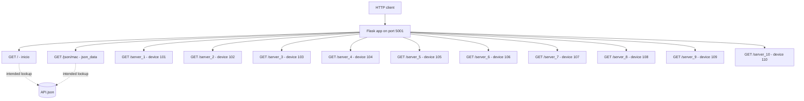

# Flask Network Device API

Small Flask project containing network-device data and practice scripts. The current Git branch is `feature/FlaskV01`. This README records the repository state and route behavior observed in `app.py` and `API.json` on 2026-09-28.

## Project files

| File | Purpose |
| --- | --- |
| `app.py` | Flask application and HTTP routes. |
| `API.json` | Network-device records keyed by MAC-like identifiers. |
| `C3.py`, `c4.py`, `c5.py`, `Examen.py` | Standalone Python practice exercises; not imported by the Flask routes. |

## Run

The app is configured to listen on port `5001` with Flask debug mode enabled:

```bash
python3 app.py
```

**Current startup blocker:** `app.py` has a syntax error in `json_data()` (`return datos_json[mac]["Name"]sf`). Python will fail to parse the module until that is corrected. After fixing the syntax, the `/` route still needs correction: `datos_json` is a list loaded from `API.json`, but the handler calls it as if it were a function. The `/json/<mac>` lookup also needs to account for the array-of-objects structure in `API.json`.

## Routes

All endpoints are currently GET routes. Use `http://localhost:5001` as the base URL after the startup errors are fixed.

| Method | URL | Handler | Intended/current behavior |
| --- | --- | --- | --- |
| GET | `/` | `inicio` | Intended to look up the record with key `3D:RF:00:01::` in `API.json`. Currently calls the loaded list as a function and will raise a runtime `TypeError`. |
| GET | `/json/<mac>` | `json_data` | Intended to return the device `Name` for the supplied key, for example `/json/3D:RF:00:01::`. Currently the handler contains a syntax error; after that is fixed, the JSON data shape still needs to be handled as a list of single-key objects. |
| GET | `/server_1` | `server_1` | Returns device `101`: Router Principal, `192.168.1.10`, policy `ALLOW_ALL`, status `Activo`. Calls `find_insert(101)` but does not use its result. |
| GET | `/server_2` | `server_2` | Returns device `102`: Router, `192.168.1.20`, policy `RESTRICTED`, status `Mantenimiento`. |
| GET | `/server_3` | `server_3` | Returns device `103`: Switch, `192.168.1.30`, policy `VLAN_ONLY`, status `Activo`. |
| GET | `/server_4` | `server_4` | Returns device `104`: Servidor principal, `192.168.1.40`, policy `STRICT_AUTH`, status `Standby`. |
| GET | `/server_5` | `server_5` | Returns device `105`: Impresora, `192.168.1.50`, policy `LOCAL_ONLY`, status `Inactivo`. |
| GET | `/server_6` | `server_6` | Returns device `106`: Firewall Perimetral, `192.168.1.1`, policy `BLOCK_IP`, status `Activo`. |
| GET | `/server_7` | `server_7` | Returns device `107`: PC, `192.168.1.60`, policy `USER_DEFAULT`, status `Activo`. |
| GET | `/server_8` | `server_8` | Returns device `108`: TV, `192.168.1.70`, policy `GUEST_ACCESS`, status `Desconectado`. |
| GET | `/server_9` | `server_9` | Returns device `109`: Camara Seguridad IP, `192.168.1.80`, policy `STREAM_ONLY`, status `Activo`. |
| GET | `/server_10` | `server_10` | Returns device `110`: Servidor Web, `192.168.1.90`, policy `HTTP_HTTPS_ONLY`, status `Mantenimiento`. |

The `/server_1` through `/server_10` handlers return their data using Flask `jsonify()`. The shown device values are currently hard-coded in `app.py`; they are not read from `API.json`.

## Route map



## Git branches and workflow

### Observed repository state

- Current local branch: `feature/FlaskV01`.
- The repository has no commits yet, so there is no commit history from which to infer earlier branch conventions.
- The remote `origin` is `https://github.com/Landeros3165p/Flask.git`.
- Before pushing this initial commit, the remote advertised `Feature`, `Hotfix`, `Patch`, `main`, `release`, `release01`, and `release02`; they all pointed to the same commit at that time.
- The local `feature/FlaskV01` branch is separate from those existing remote branch names and is intended to be pushed as a new branch.

### Suggested branch workflow

The following is a recommendation for future work, not a description of additional branches that already exist:

- Keep `main` as the stable integration branch.
- Create `feature/<short-description>` for new features, such as `feature/device-lookup`.
- Create `fix/<short-description>` for bug fixes, such as `fix/json-routes`.
- Merge reviewed, tested work into `main`; avoid committing directly to `main` for feature work.
- Before creating a branch, fetch and inspect the remote branches so local branch names and work do not diverge from the shared repository.

Useful inspection commands:

```bash
git status --short --branch
git branch --all --verbose --no-abbrev
git remote -v
git fetch --all --prune
```

## Initial verification notes

The ten `/server_n` routes return hard-coded JSON objects by inspection. The app could not yet be smoke-tested because of the syntax error described above. Update this section when the route defects are fixed and tested.
